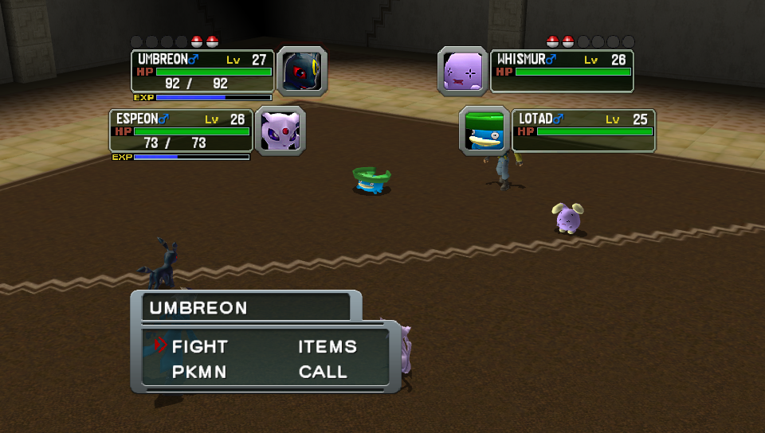

# Pokemon Colosseum Vita

</img><br>

Port of Pokemon Colosseum for PSVita based off [the decompilation](https://github.com/dougchansan/pkmn-colosseum) of the Gamecube version.

# Disclaimer

The game has not been tested start to finish, so issues may arise. Please report any bug, glitch, crash or low performance issues.
When the game misses a shader in cache, the related model won't show up for a few seconds. In case this happens, please share your `ux0:data/colosseum/native/shadercache/vgx_shaderlist.bin` so that your collected shaders can be integrated in the shared cache inside the vpk.

## Features

- 960x544 internal resolution.
- MSAA 4x antialiasing.
- Ability to fast scroll with L/R through pokemons in the Summary screen.
- Widescreen support (Defaults to On).

## Special Controls

- Additional options menu accessible by touching the top-left portion of the screen.

## How to Install

- Install `libshacccg.suprx`, if you don't have it already, by following [this guide](https://samilops2.gitbook.io/vita-troubleshooting-guide/shader-compiler/extract-libshacccg.suprx).
- Install [CapUnlocker](https://github.com/GrapheneCt/CapUnlocker/tree/master).
- Install the vpk from the Release tab.
- Extract the `setup.zip` from the Release tab in a folder in your PC.
- Place the iso file of `Pokemon Colosseum NTSC-U (GC6E01, Revision 0)` for Gamecube named as `colosseum.iso` in the same folder where you extracted the zip.
- If you don't have it already, install [Python 3.10 or higher](https://www.python.org/downloads/windows/).
- Open a command line in the same folder where you extracted the zip and run: `python -m pip install numpy`
- Run: `python tools/setup_colosseum_data.py --iso "colosseum.iso" --out output`
3. Copy the folder `output/data/colosseum` to `ux0:data/colosseum` on the Vita, so that you have:
   ```
   ux0:data/colosseum/colosseum-data.psarc
   ux0:data/colosseum/movies.psarc
   ```

## Credits

- dougchansan for the [decompilation of the game](https://github.com/dougchansan/pkmn-colosseum)
- Standard-Republic for the Livearea assets.
